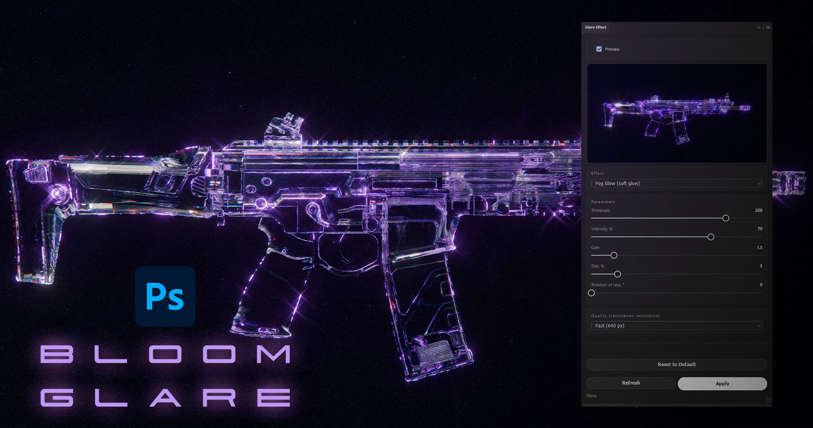
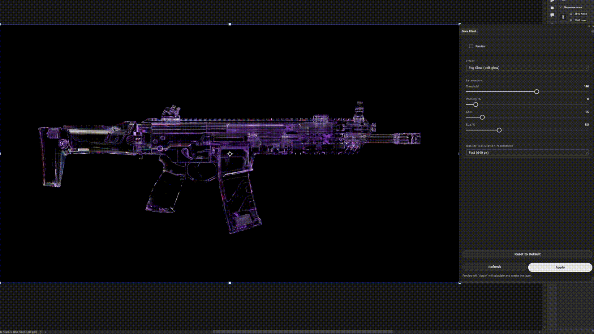

<p align="center">
  
</p>

<h1 align="center">Glare & Bloom</h1>

<p align="center">
  <strong>Photoshop plugin inspired by Blender's Glare node</strong>
</p>

<p align="center">
  Add cinematic bloom, streaks and lens flare effects directly in Adobe Photoshop.
</p>

<p align="center">
  
  
</p>

---

## 🎬 About

**Glare & Bloom** is an Adobe Photoshop plugin designed to reproduce the look and workflow of Blender's **Glare** compositor node.

It allows you to quickly add glowing highlights, cinematic streaks and lens flare effects to your images without leaving Photoshop.

The plugin supports **Adobe Photoshop 2023 (24.2) and later**.

---

## ✨ Features

### 🌟 Bloom

Creates a soft glow around bright areas of the image.

<p align="center">
  
</p>

---

### 💫 Streaks

Adds cinematic horizontal light streaks to bright areas.

<p align="center">
  
</p>

---

### 🔥 Flare

Generates a lens flare effect with glowing highlights.

<p align="center">
  
</p>

---

### 🎨 Custom Flare

Create a more customized flare effect for your artwork.

<p align="center">
  
</p>

---

## 📦 Installation

### 1. Locate your Photoshop installation

Open your Adobe Photoshop installation directory.

For example:

```text
(YOUR DISK):\Program Files\Adobe\Adobe Photoshop (YOUR VERSION)\
```

### 2. Open the Plugins folder

Navigate to:

```text
Adobe Photoshop\Plug-ins
```

For example:

```text
C:\Program Files\Adobe\Adobe Photoshop 2025\Plug-ins
```

### 3. Install the plugin

Extract the **Glare & Bloom** plugin folder from the downloaded archive and place it inside the `Plug-ins` folder.

Your folder structure should look similar to:

```text
Adobe Photoshop\
└── Plug-ins\
    └── Glare\
        ├── ...
        └── ...
```

### 4. Restart Photoshop

Restart Adobe Photoshop after installation.

The plugin should now be available inside Photoshop.

### 5. Open Glare & Bloom

After restarting Photoshop, open the plugin from:

Filter → Glare & Bloom

> If the plugin does not appear, make sure that:

> The plugin folder is placed directly inside the Plug-ins folder.

> You are using Photoshop 2023 (24.2) or newer.

> Photoshop was completely restarted after installation.

---

## 🖥️ Requirements

- **Adobe Photoshop 2023 (24.2) or newer**
- Windows
- Sufficient GPU/CPU performance for real-time image processing

---

## 🧩 Effects

| Effect | Description |
|---|---|
| 🌟 **Bloom** | Soft glow around bright areas |
| 💫 **Streaks** | Cinematic light streaks |
| 🔥 **Flare** | Lens flare effect |
| 🎨 **Custom Flare** | Customizable flare effect |

---

## 💡 Inspiration

The plugin is inspired by the **Glare** node from Blender's Compositor.

The goal is to bring a similar workflow directly into Photoshop while keeping the effects quick and easy to use.

---

## 📄 License

Add your license information here.

---

<p align="center">
  Made with ❤️ for Photoshop & Blender artists
</p>
