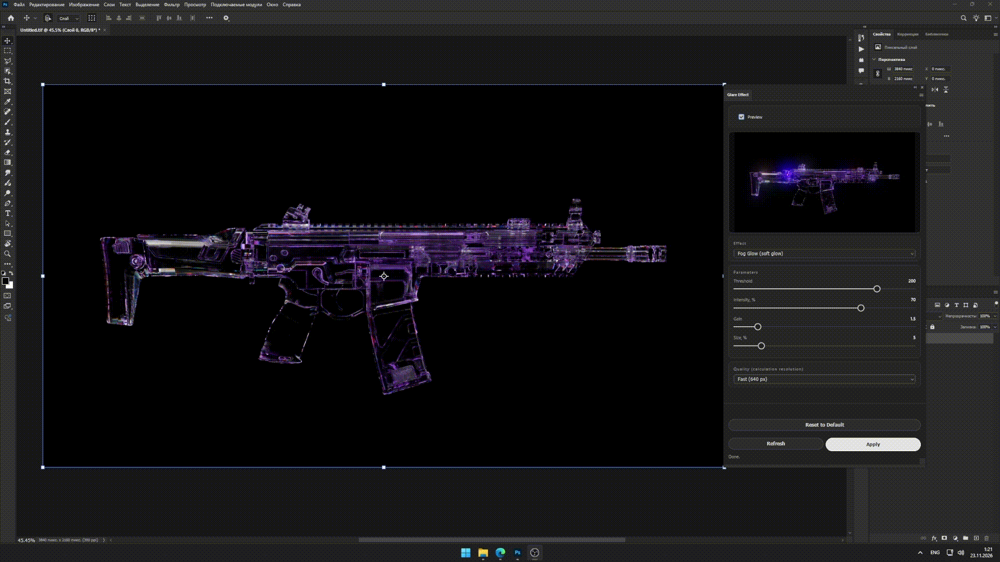
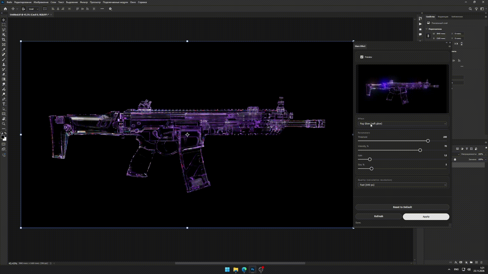

  

  <strong>Glare & Bloom</strong>

  <strong>A Photoshop plugin that functions like the "glare" node in Blender</strong>

The plugin works with Photoshop 2023, version 24.2 and later. The plugin functions like the "Glare" node in the Blender software.

> ## How do I install it?
1. Go to the Photoshop folder, for example:
2. (YOUR DISK):\Adobe\Adobe Photoshop (YOUR VERSION)\Plug-ins
3. Extract the folder from the archive into the folder (Plug-ins)

## Plugin functions:

BLOOM
  
  
STREAKS

FLARE

CUSTOM FLARE

